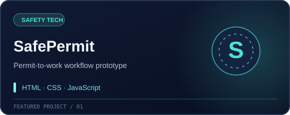
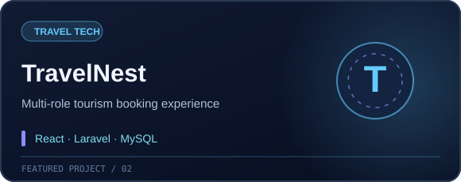
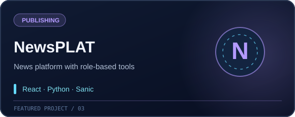
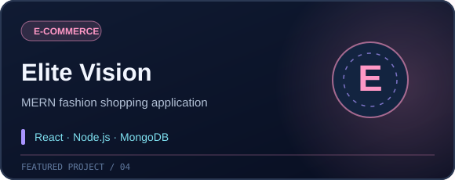
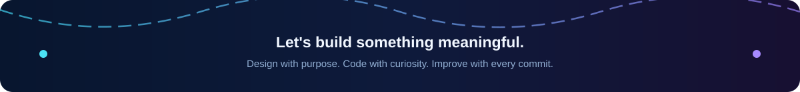

<!-- Designed for the GitHub profile repository: osamabanihani/osamabanihani -->
<div align="center">



<br/>

<a href="https://github.com/osamabanihani"></a>

<br/>

<a href="https://only-html-css-portfolio.vercel.app/"></a>
<a href="https://www.linkedin.com/in/osama-banihani-/"></a>
<a href="mailto:osamabanihani124@gmail.com"></a>
<a href="https://github.com/osamabanihani?tab=repositories"></a>

<br/><br/>


</div>

<br/>

## ✦ About me

<table>
<tr>
<td width="58%" valign="top">

### Hello, I'm Osama 👋

A **Computer Science graduate from Jadara University** and a **full-stack developer** who enjoys turning complex ideas into clear, useful digital products.

I work across **frontend interfaces, backend APIs, databases, and mobile apps**. My favorite part of software development is connecting thoughtful user experiences with reliable underlying systems.

- 🔭 Building web apps, APIs, and practical product prototypes
- 🧩 Interested in clean architecture, role-based systems, and UI/UX
- 🌱 Growing my skills in **ASP.NET Core MVC, React, and full-stack engineering**
- 🤝 Open to collaborating on ambitious, meaningful projects

</td>
<td width="42%" valign="top">

```ts
const osama = {
  role: "Full-Stack Developer",
  location: "Jordan",
  degree: "B.Sc. Computer Science",
  university: "Jadara University",
  loves: ["Web", "Mobile", "APIs"],
  approach: "Think. Build. Improve.",
  status: "Always learning"
};
```

</td>
</tr>
</table>

## ⚡ What I build

| 🌐 Modern Web Apps | ⚙️ APIs & Backend | 📱 Mobile Experiences | 🗄️ Data-Driven Systems |
|:---:|:---:|:---:|:---:|
| Responsive, accessible UIs | REST APIs & authentication | Flutter interfaces & flows | Relational and NoSQL models |
| React, JavaScript, Bootstrap | Node.js, Express, ASP.NET | Dart, Android development | SQL Server, MongoDB, Firebase |

## 🛠️ Tech arsenal

<div align="center">

**Frontend & UI**


**Backend & languages**


**Mobile & databases**


**Engineering tools**


<br/>


</div>

## 🚀 Featured work

<p align="center">A few projects that represent how I approach real problems, systems, and product design.</p>

<table>
<tr>
<td width="50%" valign="top">
<a href="https://github.com/osamabanihani/SafePermit"></a>
<br/><b>01 · <a href="https://github.com/osamabanihani/SafePermit">SafePermit</a></b><br/>
A bilingual permit-to-work <b>frontend prototype</b> featuring multi-role dashboards, review workflows, and safety-oriented interfaces.
</td>
<td width="50%" valign="top">
<a href="https://github.com/osamabanihani/TravelNest"></a>
<br/><b>02 · <a href="https://github.com/osamabanihani/TravelNest">TravelNest</a></b><br/>
A tourism booking platform bringing together travelers, companies, and administrators in one product experience.
</td>
</tr>
<tr>
<td width="50%" valign="top">
<a href="https://github.com/osamabanihani/NewsPLAT"></a>
<br/><b>03 · <a href="https://github.com/osamabanihani/NewsPLAT">NewsPLAT</a></b><br/>
A full-stack publishing platform with distinct reader, journalist, and admin workflows.
</td>
<td width="50%" valign="top">
<a href="https://github.com/osamabanihani/elite-vision"></a>
<br/><b>04 · <a href="https://github.com/osamabanihani/elite-vision">Elite Vision</a></b><br/>
A MERN-powered fashion e-commerce app with authentication, product browsing, and responsive shopping flows.
</td>
</tr>
</table>

### More things I've built

| Project | What it explores | Stack |
|---|---|---|
| [🤖 React AI Chatbot](https://github.com/osamabanihani/react-ai-chatbot) | Streaming chat, Markdown rendering, glass-style UI | React · Axios |
| [🎬 Movie Explorer](https://github.com/osamabanihani/movie-explorer) | Movie discovery and interactive browsing | React · TMDB |
| [📱 Flutter Project](https://github.com/osamabanihani/flutter-project) | Cross-platform mobile UI and app architecture | Flutter · Dart |
| [🧑‍💻 Portfolio Website](https://github.com/osamabanihani/only-html-css-portfolio) | Responsive personal portfolio built with web fundamentals | HTML · CSS · Bootstrap |

<div align="center"><a href="https://github.com/osamabanihani?tab=repositories"></a></div>

## 💼 Experience & learning

| Period | Experience | Highlights |
|---|---|---|
| **2026** | **Full Stack Developer · DOT Jordan** | MERN apps, REST APIs, collaboration with Git |
| **2025** | **Flutter Developer · DOT Jordan** | Mobile interfaces, reusable widgets, API integration |
| **2023** | **Web Development Trainee · Tuned Applications** | ASP.NET and responsive frontend development |
| **2021–2025** | **B.Sc. Computer Science · Jadara University** | Computer science fundamentals and software engineering |

## 📊 Development dashboard

<div align="center">


<br/>


<br/>


<sub>These statistics are generated by third-party services and may be delayed or temporarily unavailable.</sub>

</div>

## ✨ Beyond the code

I care about **polished interfaces, practical engineering, teamwork, and the small details that make software enjoyable to use**.

Whether I'm building a dashboard, connecting a database, or designing a mobile flow, the goal is the same: **ship something useful, learn from it, and make the next version better.**

## 🤝 Let's connect

<div align="center">

**Have a project in mind, or want to collaborate? I'd love to hear about it.**

<a href="mailto:osamabanihani124@gmail.com"></a>
<a href="https://www.linkedin.com/in/osama-banihani-/"></a>
<a href="https://only-html-css-portfolio.vercel.app/"></a>

<br/><br/>



</div>
